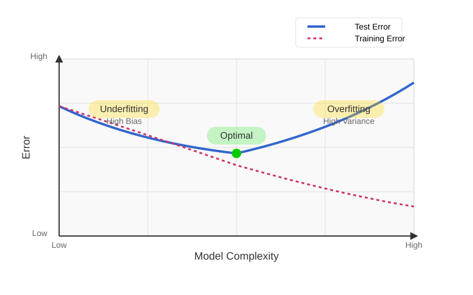
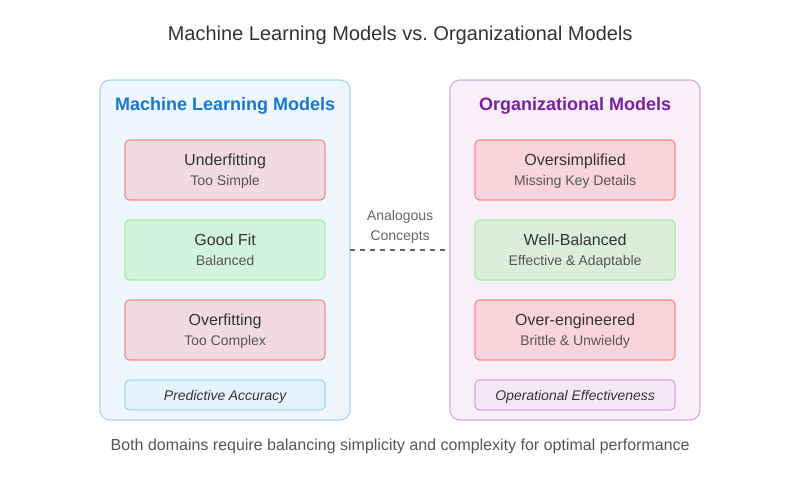
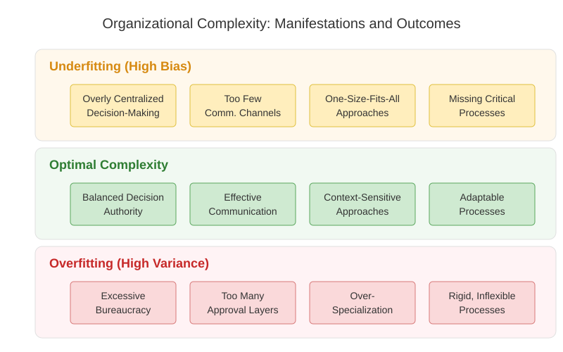

# 1. Introduction

## Table of Contents
- [1.1 Understanding Underfitting and Overfitting](#underfitting-and-overfitting)
- [1.2 Purpose and Scope](#purpose-and-scope)
- [1.3 Core Analogy](#core-analogy)
- [1.4 Manifestations in Practice](#manifestations-in-practice)

Overfitting and underfitting are concepts from machine learning that I keep recognizing in my work as a software
engineer — in how we estimate projects, design organizations, and manage complexity. This publication explores
those parallels.

The central idea is that software development and organizational design face the same fundamental tension as
model building: balancing simplicity and complexity. Getting this wrong looks remarkably similar across all
three domains.

***

## 1.1 Understanding Underfitting and Overfitting

In machine learning, [underfitting and overfitting](https://www.ibm.com/think/topics/overfitting-vs-underfitting)
represent two fundamental challenges in building models that generalize well.

**Underfitting** occurs when a model is too simplistic, leading to **high bias** and low variance. It makes strong,
often incorrect assumptions about the data, missing important patterns and performing poorly on both training and
unseen data.

<figure>
  
  <figcaption>Figure 1.1: The U-shaped relationship between model complexity and error rates</figcaption>
</figure>
  

Conversely, **overfitting** arises when a model becomes excessively complex, learning not only the underlying patterns
but also the noise and random fluctuations specific to the training data. This produces **low bias** and high variance —
the model performs well on data it has "memorized" but fails to generalize, becoming brittle in practice. The challenge
is striking a balance: enough complexity to capture essential patterns without learning the noise.

## 1.2 Purpose and Scope

The analogy applies in two main areas: **time estimation** (a predictive model forecasting duration, effort, and
cost) and **organizational structures** (models of communication patterns, hierarchies, and responsibilities).
Beyond these, the publication also examines:

- Stakeholder preferences
- The influence of organizational size and type on modeling approaches
- Connections to related theoretical concepts like long-tail distributions and dissipative systems theory
- A case study in medical information systems, considering "strategic overfitting" and modular design

**Artificial Intelligence** adds a major complication. AI assistants and agents are
[transforming organizational workflows](https://www.wired.com/story/artificial-intelligence-work-organizational-strategy/)
and reshaping the under/overfitting dynamics in every domain discussed here. The core analogies still hold, but AI
introduces new dimensions — Chapters 8 and 9 explore how it is changing organizational structures, skill
requirements, and the way we manage complexity.

### The Chapter Progression

This publication presents a logical progression that builds the analogy from fundamentals to complex applications. [Chapter 2](../chapters/02-software-time-estimation.md) introduces time estimation as a predictive modeling problem, examining how underfitting and overfitting manifest in software development forecasting. [Chapter 3](../chapters/03-organizational-models.md) extends these concepts to organizational structures, exploring how they balance simplicity and complexity. [Chapter 4](../chapters/04-stakeholder-preferences.md) adds another dimension by analyzing how stakeholder dynamics and competing perspectives influence domain complexity. [Chapter 5](../chapters/05-organizational-size-lifecycle-adaptation.md) investigates how organizational size, life-cycle phases, and model adaptation affect the underfitting/overfitting balance. [Chapter 6](../chapters/06-theoretical-concepts.md) connects these ideas to broader theoretical concepts like entropy and dissipative systems. [Chapter 7](../chapters/07-medical-systems-case.md) provides a case study in medical systems to demonstrate these principles in action. [Chapters 8](../chapters/08-ai-organizational-impact.md) and [9](../chapters/09-ai-people-theory-practice.md) then explore how AI integration fundamentally transforms these dynamics — first examining organizational impacts, then focusing on human adaptation and theoretical frameworks. Finally, [Chapter 10](../chapters/10-conclusion.md) synthesizes the insights from this journey, presenting a unified view of complexity management across domains.

Throughout, the analysis is grounded in recognizable workplace situations — planning poker sessions, Monte Carlo
simulations, organizational communication patterns, healthcare regulatory compliance — rather than staying purely
theoretical. Ideas from [system dynamics](https://en.wikipedia.org/wiki/System_dynamics),
[feedback](https://en.wikipedia.org/wiki/Feedback) theory, and
[cybernetics](https://en.wikipedia.org/wiki/Cybernetics) inform the underlying thinking about how these systems
regulate themselves and adapt.

## 1.3 Core Analogy

The fundamental idea behind the core analogy is that both machine learning models and models in software development and
organizational design are attempts to represent complex realities. Organizational structures, often depicted as charts
or processes, are simplified representations of complex social systems. Similarly, software time estimation functions as
a predictive model forecasting outcomes based on available information.

Just as a machine learning model balances signal and noise, software development models and organizational
structures must balance simplicity and complexity. **[Domain-Driven Design
(DDD)](https://learn.microsoft.com/en-us/archive/msdn-magazine/2009/february/best-practice-an-introduction-to-domain-driven-design)**
offers strategies for managing this balance in software. And **[Conway's
Law](https://martinfowler.com/bliki/ConwaysLaw.html)** — the observation that organizations produce systems
mirroring their own communication structures — shows that organizational and software models are not independent
choices but deeply coupled.

### Two Dimensions of Fitting

A crucial nuance of this analogy is that "fitting" operates along two distinct dimensions: **structural complexity**
and **domain representation**. These dimensions are independent — an organization can overfit on one while
underfitting on the other.

The more common pattern is overfitting structurally (excessive bureaucracy, rigid processes) while underfitting
the domain (oversimplifying the problem space). This resolves an apparent tension explored in later chapters: management
often prefers simpler domain models while simultaneously creating complex organizational structures. These aren't
contradictory — they reflect different dimensions of the fitting challenge.

The reverse also occurs: organizations sometimes underfit structurally (insufficient coordination mechanisms) while
overfitting domain complexity through excessive specialization. Both patterns illustrate that finding the right balance
requires attending to each dimension separately.

<figure>  <figcaption>Figure 1.2: Analogous concepts between machine learning and organizational
models</figcaption> </figure>
  

***

## 1.4 Manifestations in Practice

<figure>  <figcaption>Figure 1.3: Real-world manifestations of
underfitting and overfitting in organizational contexts</figcaption> </figure>
   

Consider a software team estimating a new project. An **underfitted** approach might be a single gut-feel number —
"about three months" — ignoring differences in feature complexity, team familiarity with the technology, and
integration risks. The estimate is simple to produce but almost guaranteed to be wrong, because it assumes the
project is more uniform than it actually is.

The **overfitted** response is to build an elaborate estimation model calibrated to one previous project: weighting
dozens of factors, tracking velocity curves from that specific team composition, adjusting for the exact ratio of
frontend to backend work last time. The model fits the historical data beautifully — and breaks the moment the new
project differs in ways the model didn't anticipate, which it inevitably will.

The same tension plays out in organizational design, architecture decisions, and process frameworks — each of which
the following chapters examine in turn.

[Back to Table of Contents](../README.md) 
